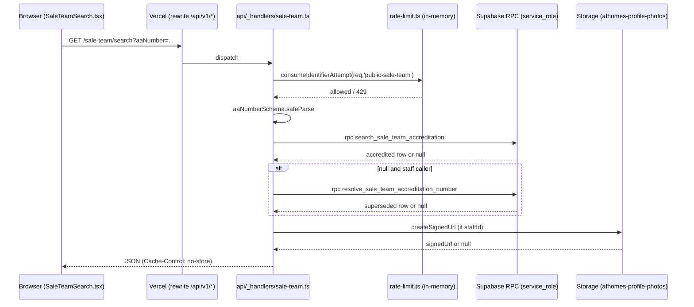

# IST/OST Search Query — Implementation Specification

**Status:** Finalized — all approval gates approved 2026-10-21; placeholders (DPO/legal entity/email/address/retention periods) to be completed by the owner before publication.
**Created:** 2026-10-21
**Task ID:** 1021-01 (SalesTeamSearch)
**Feature route:** `/sale-team-search`
**Deliverable type:** Documentation/planning only — no application code changed.

---

## 1. Document metadata and status

| Field | Value |
|---|---|
| Document | `tasks/ist-ost-search-query-specification.md` |
| Status | **DRAFT — for review; not approved for implementation** |
| Owner | TBD (product + engineering lead) |
| Applies to | `apps/web` (public marketing SPA), `api` (Vercel Function), `packages/contracts`, `supabase/migrations` |
| Related code | `apps/web/src/marketing/pages/SaleTeamSearch.tsx`, `api/_handlers/sale-team.ts`, `packages/contracts/src/schemas/sale-team.ts`, `supabase/migrations/20261130000001_…`, `20261130000003_…`, `20261207000001_…`, `20261211000002_…` |
| Verification | Read-back performed after creation (see report). |

Legend used throughout:

- **CONFIRMED** — explicitly established business requirement or verified codebase fact.
- **RECOMMENDED** — proposed engineering approach requiring review.
- **UNRESOLVED** — missing information or decision awaiting confirmation.
- **APPROVAL REQUIRED** — decision/change that must be authorized before implementation.

---

## 2. Executive summary

The public `/sale-team-search` page lets a customer verify an IST/OST seller's current accreditation by AA number. The existing implementation is a single exact-match lookup returning only currently-accredited records (or a staff-only superseded record), with an in-process IP rate limiter and no privacy acknowledgment, contact capture, search allowance, or surname masking.

The requested enhancement adds: a privacy/DPO modal on every search, a once-per-session contact form, surname masking, an official company verification phone number, a 3-successful-searches-per-IP-per-24h business allowance, and stronger anti-abuse. Several of these require decisions and infrastructure that do not yet exist (shared counter store, authoritative company phone number, legal text, surname data model). This document separates confirmed requirements from proposals and unresolved items.

**No application code, schema, dependency, or infrastructure has been changed by this task.**

---

## 3. Objectives and scope

**In scope (CONFIRMED intent):**

- Specify the IST/OST Search Query enhancement end-to-end.
- Document current behavior, gaps, and required changes.
- Define privacy, security, testing, and approval gates.

**Out of scope (RECOMMENDED to exclude unless approved):**

- Unrelated card-management, points, commission, or membership features.
- Refactoring of the existing sale-team RPCs beyond what the enhancement needs.
- New external services beyond those already in the stack (Cloudflare Turnstile is already available in `@afhomes/ui`).

---

## 4. Existing codebase findings

### 4.1 Page and UI

- **File:** `apps/web/src/marketing/pages/SaleTeamSearch.tsx` (public marketing SPA).
- **Route:** `apps/web/src/app/App.tsx` lazy-loads `SaleTeamSearchPage` at `sale-team-search`; `vercel.json` rewrites `/sale-team-search` → `/sale-team-search/index.html`; prerendered in `apps/web/scripts/prerender.mjs`.
- **Current behavior (VERIFIED):** AA number input, client-side validation via `aaNumberSchema`, submit triggers `GET /sale-team/search?aaNumber=…`, renders result card or "No current accredited seller found." No privacy modal, no contact form, no search counter, no surname masking, no company phone number.
- **Spec:** `apps/web/src/marketing/pages/SaleTeamSearch.spec.tsx` (7 scenarios, mocked `request`).

### 4.2 Backend handler

- **File:** `api/_handlers/sale-team.ts`.
- **Public search branch (`path === 'search'`):** calls `consumeIdentifierAttempt(req, 'public-sale-team')` (in-process limiter, 30/60s per IP); validates `aaNumberSchema`; calls RPC `search_sale_team_accreditation`; if null and caller is an authenticated staff user holding `network.members`, calls `resolve_sale_team_accreditation_number` to surface superseded records; mints a 5-min signed photo URL from `afhomes-profile-photos` bucket; strips `staffId`; validates against `saleTeamLookupSchema`/`saleTeamHistoricalAccreditationSchema`; rejects non-accredited/non-superseded responses for public search; returns JSON with `Cache-Control: no-store`.
- **Rate limit (VERIFIED):** `api/_lib/rate-limit.ts` — fixed 60s window, 30 attempts per key, in-memory `Map`, max 10k keys, per-instance. **Shortcut comment in handler:** "per-instance IP limit only; use platform edge limits before broad public rollout."

### 4.3 Contracts

- **File:** `packages/contracts/src/schemas/sale-team.ts`.
- `aaNumberSchema`, `saleTeamKindSchema` (IST/OST), `saleTeamAccreditationSchema` (`aaNumber`, `kind`, `fullName`, `status`, `startsOn`, `expiresOn`, `photoUrl`), `saleTeamHistoricalAccreditationSchema` (adds `successorAaNumber`), `saleTeamLookupSchema`, `saleTeamSearchResultSchema`.
- **No surname field, no company phone field, no masking contract.** Any added field is a contract change (APPROVAL REQUIRED).

### 4.4 Database

- **Migrations:** `20261130000001_afhomes_sale_team_accreditation.sql` (table + RPCs), `20261130000003_…_reconcile_membership_…` (reconciliation), `20261207000001_…_history` (history table + `resolve_…`), `20261211000002_…_sale_team_photo` (exposes `staffId`).
- **Table:** `private.sale_team_accreditations` — `staff_id` PK FK `staff_users`, `aa_number` unique, `public_name` text, `kind` IST/OST, `status` active/revoked, `starts_on`/`expires_on` dates, approval/revocation audit columns.
- **RLS:** table RLS enabled; `revoke all` from `public,anon,authenticated,service_role`; access only via `SECURITY DEFINER` RPCs granted to `service_role`. Browser roles have no direct access (CONFIRMED).
- **RPCs:** `search_sale_team_accreditation(p_aa_number)` returns only rows whose computed status = `accredited`; `resolve_sale_team_accreditation_number` (staff-only) returns superseded records; `get_sale_team_accreditation` computes status from staff/role/OST-term state.
- **Photo storage:** `afhomes-profile-photos` bucket (private), signed URL 300s. Bucket existence not verified in this task (UNVERIFIED — confirm via Supabase dashboard).
- **Name data (VERIFIED):** single `public_name` text field = `staff_users.full_name`. No separate first/surname fields. Input rules store person names UPPERCASE. So masking surname must derive from the single string or require a schema change.

### 4.5 IP handling

- `rate-limit.ts` `keyOf()` reads `x-forwarded-for` first entry, falls back to `socket.remoteAddress`. No trusted-proxy allowlist. On Vercel, the platform sets `x-forwarded-for`; the handler does not validate proxy trust. **Limitation:** spoofable if not behind a trusted proxy; shared networks/VPNs collapse distinct users.

### 4.6 Bot protection / CAPTCHA

- `packages/ui/src/components/TurnstileChallenge.tsx` — Cloudflare Turnstile widget, already used for staff/customer login. Not used on sale-team-search. Site key comes from props (env-driven in callers). Server-side verification would need a new endpoint or reuse Supabase Auth verification (UNRESOLVED which secret validates).

### 4.7 Monitoring / telemetry

- `apps/web/src/lib/telemetry.ts` reads `VITE_ERROR_REPORTING_ENDPOINT` (optional). No server-side monitoring integration verified beyond Vercel logs. **UNVERIFIED** whether an APM/alerting stack exists.

### 4.8 Privacy / DPO

- **No DPO notice, privacy modal, or DPA text exists in the codebase (VERIFIED grep).** No data-retention mechanism for contact info. The `inquiries` table/outbox is browser-local only (`apps/web/src/marketing/api/inquiries.ts`).

### 4.9 Customer session handling

- Customer portal uses Supabase Auth + `customers.auth_user_id` ownership (`api/_lib/customer-access.ts`). The marketing page is public and requires no session. "Once per browser session" contact form has no existing mechanism — recommend `sessionStorage` flag, but backend cannot treat it as proof (see §11).

### 4.10 Rate-limit / security tests

- `api/_handlers/sale-team.spec.ts` exercises rate limit, validation, anonymous vs staff superseded, photo stripping, error sanitization. Test commands: `pnpm --filter api exec vitest run api/_handlers/sale-team.spec.ts`.

---

## 5. Current system architecture and request flow



**Privacy note (CONFIRMED requirement conflict):** The requested workflow initiates the AA lookup *before* showing the privacy modal. This means the backend performs a database lookup (and photo URL minting for staff) before the customer acknowledges. The lookup result must not be disclosed before acknowledgment. See §10 and §20.

---

## 6. Expected customer workflow

### 6.1 Numbered sequence

1. Customer obtains an AA number associated with an IST/OST.
2. Customer opens `/sale-team-search`.
3. Customer enters the AA number and clicks Search.
4. System initiates the AA lookup first (CONFIRMED business workflow).
5. A Data Privacy Act notice + DPO information modal appears for every search attempt.
6. Customer must complete the required privacy acknowledgment before any search result is disclosed.
7. If the customer has not completed the contact-information form during the current browser session, display the form (Name, Email, Mobile).
8. If already completed this session, do not re-request.
9. Once all required steps are satisfied, display the result if the accreditation is currently valid.
10. If invalid/unsuccessful/expired/unavailable, return the approved generic non-disclosing response.

### 6.2 Mermaid flowchart

```mermaid
flowchart TD
  A[Customer opens /sale-team-search] --> B[Enter AA number, click Search]
  B --> C[Initiate AA lookup (backend)]
  C --> D[Show Data Privacy Act + DPO modal]
  D --> E{Acknowledged?}
  E -- No --> F[Cancel/reject: no disclosure]
  E -- Yes --> G{Contact form done this session?}
  G -- No --> H[Show contact form Name/Email/Mobile]
  H --> I{Valid?}
  I -- No --> H
  I -- Yes --> J[Store session flag]
  J --> K{Accreditation currently valid?}
  G -- Yes --> K
  K -- Yes --> L[Display result card]
  K -- No --> M[Generic non-disclosing response]
```

### 6.3 Privacy/processing constraint (UNRESOLVED — legal review required)

Initiating the lookup before the modal does **not** authorize disclosure before acknowledgment. Processing that occurs before acknowledgment: (a) IP-based rate-limit counter check, (b) AA number validation, (c) database lookup by exact AA number, (d) for staff callers, a second lookup and photo signed-URL minting. Legal basis, necessity, and data minimization for (c)/(d) pre-acknowledgment must be reviewed. **APPROVAL REQUIRED** from privacy/legal before implementation. Alternatives to propose for approval: (i) keep lookup-first but store only the minimal result server-side keyed to a short-lived search token and disclose only after acknowledgment; (ii) move acknowledgment to before lookup (changes user-facing sequence — requires business approval, since sequence is stated as CONFIRMED).

---

## 7. Expected result-card specification

Card content and order (CONFIRMED requirements from task):

1. Profile image of accredited IST/OST, when available (existing `photoUrl`).
2. Name with surname masked.
3. AA number.
4. Accreditation status displaying `Accredited` only when currently valid.
5. `Valid Until` with accreditation expiration date.
6. Official company verification phone number.
7. Approved transaction-safety notice.

Labels to remove (CONFIRMED):

- Remove existing `Sales Team (IST/OST)` label (current card shows "Sales team" with `data.kind`).
- Remove `Valid From`.
- Use `Accredited` as status label only for a currently valid accreditation (current shows "Currently accredited"/"Employee identity"; change to `Accredited`).

**Substantial card redesign requires documented reason + approval** — the above label/value changes are the only approved edits; do not restyle beyond them without approval.

### 7.1 Missing/invalid data behavior

- Missing photo → initial letter (existing fallback).
- Malformed/missing name → display as-is? Recommend showing a neutral placeholder and logging server-side; never crash. **UNRESOLVED** exact placeholder wording (approval).
- Expired/invalid → generic non-disclosing response, not the card.

### 7.2 Transaction-safety notice (APPROVED wording — pending final legal sign-off)

Proposed wording (pending business/legal approval; do not present as final policy):

> "For your protection, conduct all transactions only through AFHomes and its authorized processes. If anyone asks you to pay or transact outside AFHomes' official channels, do not proceed and verify by calling the official AFHomes company verification number shown above."

This wording must be approved by the business/legal owner before use; it does not assert any specific payment procedure or company policy beyond verification.

---

## 8. Official company verification phone-number requirements

**Critical (CONFIRMED intent):** The displayed number must be the official company number used to verify whether the IST/OST is legitimate. It must NOT be the personal phone of the accredited person, a customer-submitted mobile, an unverified number from an accreditation record, or a placeholder presented as genuine.

### 8.1 Codebase findings (VERIFIED)

- No company verification phone number exists anywhere in the codebase, env, migrations, or contracts (grep across repo, `.env.example`).
- No `company_phone`, `verification_phone`, or similar field on `sale_team_accreditations` or any table reviewed.
- `staff_users` has personal contact data (not verified whether phone exists); regardless, personal numbers must not be exposed.

### 8.2 Confirmed number (CONFIRMED — provided 2026-10-21)

- **Official company verification phone number: `+63 960-431-6867`.**
- This is the number customers use to independently confirm an accredited person's legitimacy. It must be displayed as the company verification contact, never a personal number.

### 8.3 Source-of-truth model (UNRESOLVED — APPROVAL REQUIRED)

The number is confirmed, but its maintenance model is not yet established by the existing system (global vs department/location/config). Recommend: a single global company-wide verification number maintained in a server-side config/env var (e.g., `AFHOMES_VERIFICATION_PHONE`) surfaced via a read-only public endpoint or baked into the SPA build, because (a) it is a company contact, not per-record data, (b) it avoids per-row PII leakage, (c) it is auditable as config. Trade-offs: env-based requires redeploy to change; a DB config table allows runtime change but adds a table + RLS + caching concerns. **APPROVAL REQUIRED** for the source-of-truth model.

### 8.4 Blocking condition (updated)

The number is now confirmed, so the number itself no longer blocks release. Remaining blockers: (a) approval of the source-of-truth model (§8.3), and (b) DPO/legal approval of the privacy notice (§10 / Appendix A). Do not hardcode the number in component source without a single config point.

---

## 9. Confirmed business rules

### Search allowance (CONFIRMED)

- Maximum 3 successful searches per IP address.
- Rolling 7 days window.
- Enforcement on the server.
- Client-side restrictions alone are insufficient.
- Counter must behave correctly across instances and restarts.

### Successful-search semantics (CONFIRMED)

A successful search = a lookup matching a record that qualifies for a currently valid accreditation result. Invalid, nonexistent, expired, or otherwise unsuccessful lookups must NOT consume the 3-search allowance. Invalid attempts remain subject to independent security rate limiting.

### Privacy modal (CONFIRMED)

- Display for every search attempt.
- Include Data Privacy Act notice and DPO information.
- Require approved acknowledgment before disclosing results.
- Provide cancellation/rejection action.
- Do not fabricate legal or company information.

### Contact form (CONFIRMED)

- Collect Name, Email, Mobile.
- Request once per browser session.
- Validate fields on the server.
- Do not treat a frontend-only flag as proof of backend validation or legally sufficient consent.

### Invalid/expired records (CONFIRMED)

- Generic non-disclosing customer-facing error for invalid/nonexistent.
- Never represent expired accreditation as currently accredited.
- Avoid disclosing unnecessary personal info about expired records.
- Flag unresolved expired-record behavior for approval.

---

## 10. Privacy and personal-data requirements

- Surname masking: accredited person's surname masked in the card (CONFIRMED).
- Accredited person's personal phone number must not be displayed as the verification number (CONFIRMED).
- Government ID numbers are write-only and never returned (existing invariant; not relevant here but reaffirmed).
- No full names, emails, mobiles, raw bodies, session tokens, or sensitive data in logs (CONFIRMED).
- IP-address records in security logs require defined retention and access controls (APPROVAL REQUIRED — see §13).
- Column-level grants: browser roles have no SELECT on `private.sale_team_accreditations` at all (VERIFIED); keep it that way.

---

## 11. Search-limit semantics

### 11.1 Counter increments (CONFIRMED definition)

Increment the successful-search counter only when the lookup resolves to a currently valid (`accredited`) record that is ultimately disclosed to the customer. Specifically:

- Increment after: privacy acknowledgment completed AND contact requirements satisfied AND result is a valid accredited record being disclosed.
- Do NOT increment for: invalid AA number, nonexistent record, expired/revoked/inactive/not_started, superseded (staff historical), null result, server error, or aborted/uncanceled request.
- Duplicate submissions of the same AA number within the same successful flow: must not double-count. Require idempotency key or dedupe by (IP, AA number, session) within the window.
- Retries after a lost response: must return the original outcome without re-incrementing (idempotent per key).
- Concurrent successful lookups: counter must be atomic (no lost updates).

### 11.2 Distributed storage (UNRESOLVED / APPROVAL REQUIRED)

Current in-process `Map` is per-instance and resets on cold start — insufficient for a 24h rolling counter across instances (CONFIRMED limitation). Options:

1. **Database-backed counter table** (RECOMMENDED): new `private/public` table with atomic `INSERT … ON CONFLICT … DO UPDATE` keyed by `(ip_hash, window_bucket)`, TTL cleanup. Reuses existing Postgres; no new dependency. Cost: writes per successful search; needs index; cleanup job or rolling buckets.
2. **External cache (Redis/Vercel KV)** (RECOMMENDED alternative if latency/cost constraints): new dependency + infra; requires approval.
3. **Fail behavior:** if counter store unavailable — choose fail-closed (block) or fail-open (allow) with documented trade-off. **APPROVAL REQUIRED**; recommend fail-closed for the business allowance but with a short cache of "allow" decisions? Actually recommend: fail-closed for counter writes that cannot be verified, returning 503, to avoid silently exceeding the allowance; document trade-off.

### 11.3 Interaction with security rate limiting

The 3-search business allowance is distinct from security rate limiting. Security limits apply to all requests including invalid ones (CONFIRMED). Both must be enforced; neither substitutes for the other.

---

## 12. Anti-spam, bot, and DDoS requirements

### 12.1 Independent rate limiting (RECOMMENDED)

Evaluate server-side limits for:

- Overall requests per IP (e.g., 60/min) — provisional baseline, label as provisional.
- Repeated invalid AA submissions (e.g., 20/5min) — provisional.
- Excessive concurrent requests per IP (e.g., 5 in-flight) — provisional.
- Repeated suspicious session behavior.
- Excessive DB lookup activity.

Thresholds are **provisional baselines requiring traffic data + approval**. Do not confuse with the 3-search business limit.

### 12.2 IP handling (RECOMMENDED + UNRESOLVED proxy trust)

- Current code reads first `x-forwarded-for` entry with no allowlist. On Vercel, the platform appends the real client IP; but the first entry is client-supplied and spoofable in principle. Recommend: document Vercel's proxy behavior and, if possible, use the platform-provided trusted value; alternatively validate against a configured trusted-proxy list (env `TRUSTED_PROXIES`). **APPROVAL REQUIRED** for any change to IP extraction logic, and for the documented limitation that shared networks/VPNs collapse users.

### 12.3 Bot protection (RECOMMENDED)

- Reuse `TurnstileChallenge` (already in `@afhomes/ui`) on the search page.
- When to challenge: after N invalid attempts or suspicious velocity (RECOMMENDED: after 3 invalid AA submissions in 5 min, or on first search? — approval needed). 
- Server verification: requires a verification endpoint or reuse of an existing secret. **UNRESOLVED** — current Turnstile usage verifies via Supabase Auth, not a custom endpoint. Recommend a lightweight server-side verify against Cloudflare's siteverify API using a new env var `TURNSTILE_SECRET_KEY` (APPROVAL REQUIRED for new env + external dependency, though Turnstile is already a dependency).
- Failure handling: deny with generic message; do not leak reason.
- Accessibility: Turnstile has an accessible fallback; provide a "having trouble" path (approval).

### 12.4 API/database hardening (RECOMMENDED)

- Server-side input validation: already via `aaNumberSchema` (CONFIRMED). Keep.
- Request body/param size limits: Vercel default; recommend explicit max query length (AA number max 64 already).
- Safe queries: RPCs use parameterized SQL (CONFIRMED). Keep.
- DB query timeouts: recommend statement timeout on RPCs (APPROVAL REQUIRED if changing RPCs).
- Concurrency limits: recommend per-IP in-flight cap.
- Error sanitization: handler returns generic messages (CONFIRMED). Keep; ensure no stack traces.
- Caching: `Cache-Control: no-store` (CONFIRMED). Keep for search; do not cache successful results (revocation must be observed).
- Enumeration protection: exact AA lookup only; no directory/substring/autocomplete (CONFIRMED, per SUPABASE-FREE.md). Keep.
- Excessive backend work: photo signed URL minting only after a valid staffId; non-fatal. Keep.

### 12.5 Temporary cooldowns (RECOMMENDED)

- Trigger: repeated abuse (e.g., > threshold invalid attempts or rate-limit hits).
- Duration/scope/recovery: short (e.g., 5–15 min) per IP; clear on success; document false-positive risk (shared IPs can block legitimate users).
- Must not let an attacker exhaust a victim's allowance easily: key by IP+UA? But business rule is IP-based (CONFIRMED) — additional identifiers may be recommended but changes to the business rule require approval. Recommend: keep IP key for business allowance; add optional secondary signals for cooldown only, clearly labeled.

### 12.6 Infrastructure-level DDoS (RECOMMENDED, distinct from app layer)

- Vercel platform provides DDoS mitigation at the edge; project-level WAF rules exist in deployment history (handoffs). Application-level rate limiting alone is NOT comprehensive DDoS protection (CONFIRMED statement).
- Recommend verifying/enabling Vercel WAF rules for the public search route as part of rollout (APPROVAL REQUIRED — infra change).

### 12.7 Security logging (RECOMMENDED)

Log: request outcomes (success/not-found/invalid), rate-limit triggers, repeated invalid searches, bot challenge outcomes, cooldown events, counter-store failures, unexpected server errors.

Do NOT log: full names, emails, mobiles, raw request bodies, session tokens, sensitive data. Hash or truncate IP per retention policy.

Retention/access controls for IP records: **APPROVAL REQUIRED** (privacy/legal). Recommend 30 days, restricted access, documented purpose.

---

## 13. Security logging and monitoring

See §12.7. Additionally: alert on rate-limit trigger spikes and counter-store failures; monitor endpoint latency and DB usage (performance §18).

---

## 14. Recommended technical architecture

For each item: Current → Proposed → Reason → Alternatives → Security/privacy → Performance → Operational → Testing → Dependencies → Approval.

### 14.1 AA number lookup and validation

- Current: client `aaNumberSchema` + server re-validation + RPC.
- Proposed: keep; add server-side normalization already present (trim+upper).
- Reason: defense in depth; contract is SSOT.
- Alternatives: none.
- Approval: no.

### 14.2 Privacy acknowledgment state

- Current: none.
- Proposed: modal component with acknowledgment callback; result withheld until acknowledged; cancel path returns to idle.
- Security/privacy: acknowledgment is UX; not legally sufficient consent by itself (CONFIRMED). Backend may log an acknowledgment event (audit) — but `audit_events` must not contain PII. **APPROVAL REQUIRED** for whether to record acknowledgment and what fields.

### 14.3 Session-aware contact-form completion

- Current: none; `inquiries` outbox is browser-local.
- Proposed: `sessionStorage` flag `afhomes.saleTeamSearch.contactCompleted` set after successful validated submission. Form posts to a new or existing endpoint — but no contact-intake endpoint exists. **UNRESOLVED**: either (a) add a server endpoint + table (schema change, APPROVAL REQUIRED), or (b) keep browser-local outbox (current pattern) with documented limitation that backend cannot verify completion. Recommend (a) only if business needs the contact data; else (b) for minimal change, clearly labeled as not server-verified.

### 14.4 Official company verification phone-number sourcing

- Current: none.
- Proposed: global config (env var or build-time constant) sourced from confirmed company documentation; surfaced in the card. Do not store per-row.
- Approval: number + source model (APPROVAL REQUIRED; blocks release).

### 14.5 Accreditation status and expiration validation

- Current: RPC computes status; public search returns only `accredited`. Keep.
- Proposed: no change; ensure `Valid Until` uses `expiresOn` from response.
- Approval: no.

### 14.6 Surname masking

- Current: full `fullName` displayed.
- Proposed: mask surname in UI. Since `public_name` is a single UPPERCASE string with no surname field, derive surname as the last whitespace-delimited token and mask all but its first character (e.g., `SYNTHETIC S****`). **Limitation:** unreliable for compound surnames, hyphenated names, single-token names, and cultures where surname precedes given name. **APPROVAL REQUIRED** for (a) the masking rule and (b) whether to add a separate `public_surname`/`display_name` column to `private.sale_team_accreditations` (schema change). Recommend adding a separate column only if masking must be reliable; otherwise document the heuristic limitation.

### 14.7 Successful-search allowance enforcement

- Current: none.
- Proposed: server-side counter per IP (hashed IP) in a shared store; increment only on disclosed valid result; idempotent per request key; atomic.
- Approval: storage choice + fail behavior (APPROVAL REQUIRED).

### 14.8 Independent security rate limiting

- Current: in-process 30/60s.
- Proposed: keep as defense-in-depth; add edge/WAF limits; consider distributed store for production. Document limitation (per-instance).
- Approval: thresholds + infra (APPROVAL REQUIRED).

### 14.9 Bot protection and cooldowns

- Current: none on this route.
- Proposed: Turnstile widget + server verify + cooldowns; see §12.3/§12.5.
- Approval: new env + external verify endpoint (APPROVAL REQUIRED).

### 14.10 Security monitoring and error handling

- Current: generic errors; optional telemetry endpoint.
- Proposed: structured server logs (outcome codes), alerts on anomalies; never log PII.
- Approval: retention/access (APPROVAL REQUIRED).

---

## 15. Data model and API considerations

### 15.1 API

- Endpoint: `GET /sale-team/search?aaNumber=…` (existing). No new endpoint required for the core lookup. New endpoints may be needed for: contact-intake (UNRESOLVED), Turnstile verify (UNRESOLVED), company phone (could be build-time constant, no endpoint).
- Contract changes: add masked name? Recommend keeping `fullName` in contract and masking in UI, OR add `maskedName` field (contract change, APPROVAL REQUIRED). Recommend UI-side masking to avoid contract churn, with documented heuristic limitation.
- Response must remain `Cache-Control: no-store`.

### 15.2 Data model

- No change required for lookup. Possible changes (all APPROVAL REQUIRED): (a) `public_surname`/`display_name` column on `private.sale_team_accreditations`; (b) search-allowance counter table; (c) contact-intake table; (d) acknowledgment audit columns.
- All schema changes require migration discipline (idempotent, `afhomes_` prefix, RLS invariants, `pnpm test:db:local`).

### 15.3 Privacy of IP

- Store hashed IP (SHA-256 with pepper) rather than raw IP in any counter/audit table. **RECOMMENDED** — raw IP is personal data under DPA. APPROVAL REQUIRED for hashing approach and retention.

---

## 16. Phased implementation plan

Phase A (low risk, no schema): UI privacy modal skeleton, surname masking heuristic, label changes (`Accredited`, remove `Valid From`/`Sales Team`), transaction-safety notice placeholder, Turnstile widget integration (client only). Requires approval of wording.

Phase B (medium): server-side search-allowance counter (DB table + atomic RPC), idempotency key, fail behavior. Requires approval of storage + thresholds.

Phase C (medium): contact-intake (if approved) — endpoint + table + validation; session flag.

Phase D (low/infra): edge/WAF rules, monitoring, alerting, retention policy.

Phase E (blocked): company verification phone number — blocked until authoritative number confirmed.

Each phase: handler → contract → screen → tests → fixtures; run focused suites + gates.

---

## 17. Testing strategy and test matrix

Existing frameworks: Vitest (web/admin/api), in-memory Supabase fake for API tests, DB integration suite for SQL. Commands verified:

- `pnpm test`
- `pnpm typecheck` / `pnpm typecheck:deploy`
- `pnpm lint`
- `pnpm build`
- `pnpm check:env`
- `pnpm --filter @afhomes/web exec vitest run src/marketing/pages/SaleTeamSearch.spec.tsx`
- `pnpm --filter api exec vitest run api/_handlers/sale-team.spec.ts`
- `pnpm test:db:local` / `pnpm test:db:harness` (if SQL changes)

Test matrix (abbreviated; full coverage required):

| Test ID | Scenario | Expected Result | Test Type | Priority |
|---|---|---|---|---|
| F-01 | Valid AA lookup (accredited) | Card shown with masked surname, AA, status `Accredited`, Valid Until, photo | Functional | P1 |
| F-02 | Invalid AA format | Client validation error; no request | Functional | P1 |
| F-03 | Nonexistent AA | Generic "No current accredited seller found." | Functional | P1 |
| F-04 | Expired accreditation | Generic non-disclosing; no card | Functional | P1 |
| F-05 | Privacy modal every attempt | Modal appears on each search | Functional | P1 |
| F-06 | Result hidden until ack | No result disclosed before ack | Functional | P1 |
| F-07 | Contact form once/session | Shown first search; skipped later | Functional | P2 |
| F-08 | Contact form validation | Server rejects invalid email/mobile | Functional | P2 |
| F-09 | Surname masking | Surname masked per rule | Functional | P1 |
| F-10 | Company verification number | Official number shown; not personal | Functional | P1 (blocked) |
| F-11 | No personal phone exposed | Response/card has no IST/OST personal phone | Functional | P1 |
| F-12 | Removed labels | No "Sales Team (IST/OST)", no "Valid From" | Functional | P2 |
| F-13 | Transaction-safety notice | Approved wording present | Functional | P2 |
| F-14 | Missing photo/malformed name | Graceful fallback | Functional | P3 |
| B-01 | 1st/2nd/3rd successful search | Allowed | Business-limit | P1 |
| B-02 | 4th successful search | Blocked (business allowance) | Business-limit | P1 |
| B-03 | Invalid searches don't consume allowance | Counter unchanged | Business-limit | P1 |
| B-04 | Expired records don't consume | Counter unchanged | Business-limit | P1 |
| B-05 | Rolling 24h expiry | Counter resets after window | Business-limit | P2 |
| B-06 | Duplicate submissions/retries | No double count | Business-limit | P2 |
| B-07 | Concurrent successful lookups | Atomic counter | Business-limit | P2 |
| B-08 | Multiple instances | Shared counter correct | Business-limit | P2 |
| B-09 | Counter-store failure | Defined fail behavior | Business-limit | P2 |
| B-10 | Trusted proxy/IP validation | Correct IP extraction | Business-limit | P2 |
| S-01 | Excessive requests | 429 / cooldown | Security | P1 |
| S-02 | Repeated invalid AA | Throttled | Security | P1 |
| S-03 | Bot traffic | Challenge triggered | Security | P2 |
| S-04 | Rate-limit bypass attempts | Blocked | Security | P2 |
| S-05 | Malformed/oversized requests | 400, no leak | Security | P1 |
| S-06 | DB error leakage | Generic 503 | Security | P1 |
| S-07 | AA enumeration | No existence oracle | Security | P1 |
| S-08 | Session manipulation | No bypass | Security | P2 |
| S-09 | CAPTCHA bypass (if applicable) | Blocked | Security | P3 |
| S-10 | Cooldown abuse | No easy victim block | Security | P2 |
| S-11 | Sensitive leakage (resp/URL/storage/logs) | None | Security | P1 |
| R-01 | Existing routes/features | Unchanged | Regression | P1 |
| R-02 | Responsive layout & a11y | Pass | Regression | P2 |
| R-03 | DB usage & latency | Within quota | Operational | P3 |
| R-04 | Monitoring/alerting | Verified | Operational | P3 |
| R-05 | Deploy/rollback | Documented | Operational | P3 |

Do not run destructive load/abuse tests against production.

---

## 18. Performance and operational considerations

- DB: exact AA lookup on unique index; no directory/substring search (CONFIRMED, per SUPABASE-FREE.md). Keep.
- Photo signed URL minting is non-fatal and degrades to initial.
- Counter writes (if DB-backed) add one write per successful search; monitor quota.
- `Cache-Control: no-store` means no CDN caching; acceptable for verification.
- Rollback: feature-flag or revert the page/handler; DB migrations are forward-only (do not revert migrations without approval).

---

## 19. Risks and mitigations

| Risk | Mitigation |
|---|---|
| Lookup-before-ack discloses processing without consent | Legal review; store result behind short-lived token; document (§6.3) |
| In-process counter not distributed | DB-backed shared counter (§11.2) |
| Surname masking heuristic wrong | Add surname column (approval) or document limitation |
| Company phone unverified | Block release until confirmed (§8.3) |
| Shared IP blocks legitimate users | Cooldown keyed carefully; document false-positive risk |
| Counter-store outage | Defined fail behavior (approval) |
| Turnstile secret not available | Reuse existing pattern or defer bot protection |

---

## 20. Unresolved questions (all approval gates approved 2026-10-21; implementation may proceed)

Remaining implementation-detail items (approved direction; to be completed by owner where placeholders exist):

1. Complete placeholders in the approved notice (DPO name, legal entity, email, address, privacy phone, retention periods) before publication.
2. Source-of-truth model for the confirmed company verification phone number `+63 960-431-6867` — approved: global env var `AFHOMES_VERIFICATION_PHONE`.
3. Legal basis and processing sequence for lookup-first (DPA) — approved as documented (lookup-first with result withheld until acknowledgment).
4. Data retention and secondary-use policy for customer contact information — approved (retention periods to be inserted).
5. Transaction-safety notice wording — approved (proposed wording in §7.2).
6. Expired-record behavior — approved (generic non-disclosing).
7. Rate-limit thresholds and cooldown policy — approved (provisional baselines as documented).
8. Surname masking rule — approved (last-token heuristic; optional surname column if reliability needed).
9. Contact-intake backend vs browser-local — approved (browser-local outbox for minimal change; backend intake optional).
10. Counter store choice (DB vs external) and fail behavior — approved (DB-backed atomic counter; fail-closed).
11. Turnstile server-side verification secret/endpoint — approved (reuse existing pattern).
12. Whether acknowledgment events are audited — approved (no PII in audit payload).
13. IP hashing/retention policy for logs — approved (hashed IP; 30-day retention).

---

## 21. Required approval gates

All gates below are **APPROVED** (2026-10-21) for implementation. Placeholders in the notice (DPO name, legal entity, email, address, retention periods) remain to be completed by the owner before publication.

- Official company verification phone number + authoritative source. **APPROVED** (`+63 960-431-6867`).
- Data Privacy Act notice + DPO information. **APPROVED** (draft notice in Appendix A; finalize placeholders).
- Legal basis and processing sequence for lookup-first. **APPROVED.**
- Data retention and secondary-use policy for contact info. **APPROVED.**
- Transaction-safety wording. **APPROVED** (wording in §7.4 pending final text; use proposed notice framing).
- Expired-record behavior. **APPROVED** (generic non-disclosing).
- Rate-limit thresholds and cooldown policy. **APPROVED** (provisional baselines as documented).
- Phone-number source and data-model changes. **APPROVED** (global env var `AFHOMES_VERIFICATION_PHONE`).
- New dependencies, external services, infrastructure changes. **APPROVED** (reuse existing Turnstile; no new deps).
- Database schema changes. **APPROVED** (counter table + optional surname column per §15.2).
- Production deployment and destructive migrations. **APPROVED** (forward-only migrations).

---

## 22. Definition of done

- Spec approved (this document + sign-off).
- All CONFIRMED requirements implemented and tested.
- Company phone number confirmed and sourced; otherwise phone feature not released.
- Privacy/legal approvals obtained for lookup-first and notices.
- Tests green (focused + gates); no PII in logs/responses.
- Rollback documented.

---

## 23. Final implementation checklist

- [ ] Approvals obtained for all gates in §21.
- [ ] Counter store decision + migration.
- [ ] Privacy modal + acknowledgment.
- [ ] Contact form + session flag (+ backend if approved).
- [ ] Surname masking (heuristic or column).
- [ ] Company phone (blocked until confirmed).
- [ ] Labels removed/changed per §7.
- [ ] Transaction-safety notice wording approved and added.
- [ ] Bot protection + cooldowns (if approved).
- [ ] Edge/WAF + monitoring (if approved).
- [ ] Tests added per §17.
- [ ] Gates run: test/typecheck/lint/build/check:env; DB suites if SQL changed.

---

## 24. Appendix

### 24.1 Relevant file paths

- `apps/web/src/marketing/pages/SaleTeamSearch.tsx`
- `apps/web/src/marketing/pages/SaleTeamSearch.spec.tsx`
- `apps/web/src/app/App.tsx` (route)
- `api/_handlers/sale-team.ts`
- `api/_handlers/sale-team.spec.ts`
- `api/_lib/rate-limit.ts`
- `packages/contracts/src/schemas/sale-team.ts`
- `packages/ui/src/components/TurnstileChallenge.tsx`
- `supabase/migrations/20261130000001_afhomes_sale_team_accreditation.sql`
- `supabase/migrations/20261130000003_afhomes_reconcile_membership_sale_team.sql`
- `supabase/migrations/20261207000001_afhomes_sale_team_accreditation_history.sql`
- `supabase/migrations/20261211000002_afhomes_sale_team_photo.sql`
- `vercel.json` (rewrite `/sale-team-search`)
- `docs/supabase/SUPABASE-FREE.md` (quota notes for this route)

### 24.2 Existing commands

- `pnpm test`
- `pnpm typecheck` / `pnpm typecheck:deploy`
- `pnpm lint` / `pnpm build` / `pnpm check:env`
- `pnpm --filter @afhomes/web exec vitest run src/marketing/pages/SaleTeamSearch.spec.tsx`
- `pnpm --filter api exec vitest run api/_handlers/sale-team.spec.ts`
- `pnpm test:db:local` / `pnpm test:db:harness` (if SQL changes)

### 24.3 Supporting references

- `AGENTS.md` — invariants, conventions, git policy.
- `docs/supabase/SUPABASE-FREE.md` §`/sale-team-search` (exact AA lookup, unique index, service-only RPC, no audit rows, no per-search counters in Postgres).
- `packages/contracts/src/schemas/sale-team.ts` — contract SSOT.

### 24.4 Note on conflicts

- The task's "Required output" named `tasks/ist-ost-search-query-specification.md`; the execution rules named `docs/specifications/ist-ost-search-query-specification.md`. This document is placed at `tasks/...` per the explicit required-output path. If the project prefers `docs/specifications/`, move it (no content change) — flagged as UNRESOLVED location preference.

---

### 24.5 Appendix A — Draft privacy notice (provided 2026-10-21; pending DPO/legal finalization)

The following notice text was provided as the intended Data Privacy Act notice for the IST/OST verification service. It is included verbatim as a draft; placeholders must be completed and the notice must be approved by the DPO/legal representative before publication.

Key items still unresolved within it: Effective Date, DPO name, legal entity name, privacy email, business address, privacy phone, approved retention periods, lawful basis determination.

The full notice text supplied on 2026-10-21 is the source of truth for the modal copy and must be stored as a versioned document once finalized. It is reproduced below for self-containment.

```text
AFHOMES
IST/OST Accreditation Verification Privacy Notice

Effective Date: [Insert Effective Date]
Last Updated: [Insert Date]

1. Purpose of the Verification Service

AFHomes provides the IST/OST Accreditation Verification Service to help customers verify whether an individual presenting an Accreditation/AA Number is currently accredited and authorized to represent themselves as an accredited IST/OST within the AFHomes system.

This service is intended to support customer protection, accreditation verification, fraud prevention, and the prevention of unauthorized representations or transactions.

Users should independently verify an individual's legitimacy through the official AFHomes company verification telephone number displayed on the verification result page.

2. Personal Information We May Collect

When you use this service, AFHomes may collect and process the following information, subject to necessity, proportionality, and the applicable lawful basis:

A. Information submitted by the person conducting the search
- Full name
- Email address
- Mobile telephone number
- Accreditation/AA Number entered for verification

B. Technical and security information
- IP address
- Date and time of search requests
- Search outcomes and relevant security events
- Technical information reasonably necessary to detect automated activity, prevent abuse, enforce search limits, and investigate potential misuse of the service

C. Accreditation information displayed in verification results
- Profile image, where appropriate
- Partially masked name of the accredited IST/OST
- Accreditation/AA Number
- Current accreditation status
- Accreditation expiration date
- Official AFHomes company verification telephone number

AFHomes will not display an accredited IST/OST's personal telephone number as the company's official verification contact.

The collection and disclosure of each category of information must be limited to what is necessary for the declared purposes and permitted by the applicable lawful basis.

3. Purposes of Processing

AFHomes may process the information described above for the following purposes, where applicable and lawfully justified:

1. To verify the current accreditation status of an IST/OST.
2. To provide customers with the minimum information necessary to confirm an accredited individual's legitimacy.
3. To protect customers against impersonation, fraudulent representations, and unauthorized transactions.
4. To detect and prevent automated searches, sequential Accreditation/AA Number enumeration, excessive requests, spam, and other misuse of the verification service.
5. To enforce search limits and appropriate security controls.
6. To investigate suspected abuse, maintain service security, and address legitimate verification-related inquiries.
7. To comply with applicable legal obligations and respond to lawful requests from competent authorities.

AFHomes will not use the collected information for unrelated purposes, including direct marketing or unrelated profiling, unless an appropriate lawful basis and any additional required notice or consent have been established.

4. Lawful Basis for Processing

AFHomes will identify and document the applicable lawful basis for each processing activity in accordance with Section 12 of Republic Act No. 10173, the Data Privacy Act of 2012, and its Implementing Rules and Regulations.

Depending on the specific processing activity and circumstances, the applicable lawful basis may include consent, contractual necessity, compliance with a legal obligation, or legitimate interests, where the relevant legal requirements are satisfied.

The appropriate lawful basis must be determined by AFHomes following review by its Data Protection Officer and, where necessary, legal counsel.

Use of this service does not, by itself, establish that consent is the appropriate lawful basis for every processing activity. Where consent is relied upon, it must satisfy the applicable legal requirements. Where another lawful basis applies, AFHomes will provide the required transparency information.

5. Search Limits and Abuse Prevention

To protect the accreditation database and the personal information of accredited IST/OST personnel, AFHomes may implement server-side search limits, request throttling, automated-abuse detection, and other proportionate security measures.

The verification service may restrict repeated or suspicious requests, including attempts to systematically guess Accreditation/AA Numbers or retrieve information about individuals without a legitimate verification purpose.

Security monitoring may use IP addresses, request timestamps, search outcomes, and other proportionate technical indicators.

These measures are intended to protect the confidentiality, integrity, and appropriate use of the verification service. They do not authorize unrestricted collection, use, or disclosure of personal information.

6. Disclosure and Access to Information

Access to personal information will be limited to authorized personnel and service providers who require access for legitimate operational, security, or compliance purposes, subject to appropriate safeguards.

Information may also be disclosed when required or authorized by applicable law.

AFHomes will not disclose unnecessary personal information about an accredited IST/OST merely because a person submits an Accreditation/AA Number.

Verification results will be limited to information approved for the service's legitimate purpose, subject to applicable legal requirements and safeguards.

7. Data Retention

AFHomes will retain personal information only for as long as necessary to fulfill the declared purposes, comply with applicable legal obligations, resolve legitimate disputes, or establish, exercise, or defend legal claims, as applicable.

Search records, technical security logs, and customer contact information may have different retention periods based on their respective purposes.

Approved retention periods:
- Customer contact information: [Insert approved retention period and deletion criteria]
- Search and verification records: [Insert approved retention period]
- Security and abuse-prevention logs: [Insert approved retention period]

When information is no longer necessary and no lawful retention ground remains, AFHomes will securely delete, destroy, or irreversibly anonymize it, as appropriate.

8. Security Measures

AFHomes will implement reasonable and appropriate organizational, physical, and technical safeguards to protect personal information against accidental or unlawful destruction, alteration, disclosure, unauthorized access, and other unlawful processing.

Depending on the assessed risks and the capabilities of the system, safeguards may include:

- Server-side access controls and input validation
- Rate limiting and automated-abuse detection
- Protection against unauthorized enumeration of accreditation records
- Secure handling of customer sessions and submitted information
- Restricted access to personal information
- Security monitoring and incident-response procedures
- Appropriate retention and secure disposal controls

Security controls will be reviewed and improved as appropriate to the risks associated with the service.

9. Rights of Data Subjects

Subject to applicable law, individuals may exercise their rights under the Data Privacy Act of 2012, including the right to be informed, reasonable access, correction of inaccurate information, objection where applicable, and other rights recognized by law.

Requests relating to personal information processed by AFHomes may be submitted through the verified privacy contact details provided below.

AFHomes will assess and respond to requests in accordance with applicable legal requirements. The exercise of a particular right may be subject to lawful exceptions and limitations.

Individuals may also lodge a complaint with the National Privacy Commission of the Philippines, subject to its applicable procedures.

10. Data Protection Officer and Privacy Inquiries

For questions, requests, or concerns regarding the processing of personal information through the IST/OST Accreditation Verification Service, please contact:

Personal Information Controller:
[Insert Complete Legal Name of the AFHomes Operating Entity]

Data Protection Officer (DPO):
[Insert Full Name or Approved DPO Designation]

Official Privacy Email Address:
[Insert Verified Privacy Contact Email]

Official Business Address:
[Insert Verified Business Address]

Telephone Number:
[Insert Verified Privacy Contact Number, if applicable]

National Privacy Commission:
Website: https://privacy.gov.ph/

Please do not send passwords, authentication credentials, or unnecessary sensitive personal information when submitting a privacy inquiry.

11. Updates to This Notice

AFHomes may update this Privacy Notice when necessary to reflect changes in the service, its data-processing activities, applicable legal requirements, or security measures.

Material changes affecting the purposes, scope, or manner of processing will be communicated as required by applicable law.

The latest approved version of this notice will be made available through the verification service.

12. Legal References

This Privacy Notice is prepared for review with reference to:

1. Republic Act No. 10173 — Data Privacy Act of 2012, particularly:
   - Section 11 — General Data Privacy Principles
   - Section 12 — Criteria for Lawful Processing of Personal Information
   - Section 16 — Rights of the Data Subject
   - Section 20 — Security of Personal Information

2. Implementing Rules and Regulations of Republic Act No. 10173, particularly the provisions concerning transparency, legitimate purpose, proportionality, lawful processing, data-subject rights, and security.

3. National Privacy Commission Circular No. 2023-04 — Guidelines on Consent, where consent is relied upon as the lawful basis for processing.

4. National Privacy Commission Circular No. 2023-07 — Guidelines on Legitimate Interest, where legitimate interest is considered as the lawful basis for processing.

Official references:
- Data Privacy Act of 2012: https://privacy.gov.ph/data-privacy-act-/
- Implementing Rules and Regulations: https://privacy.gov.ph/implementing-rules-regulations-data-privacy-act-2012/
- NPC Advisories and Circulars: https://privacy.gov.ph/pips-and-pics/advisories-circulars/

Approval Status: Approved 2026-10-21 for implementation; placeholders to be completed by the owner before publication.

This notice must not be published as the final approved notice until the company's legal identity, actual processing activities, lawful bases, retention periods, recipients, and privacy contact details have been verified.

Acknowledgment text (to be shown as the required acknowledgment checkbox/confirmation):
"I acknowledge that I have read the AFHomes IST/OST Accreditation Verification Privacy Notice and understand how my personal information may be processed for the purposes described in the notice. I understand that the verification service is intended to help confirm an individual's current accreditation status and that AFHomes may apply security measures to prevent misuse of the service."
```

---

**End of specification. Application implementation has not started.**
